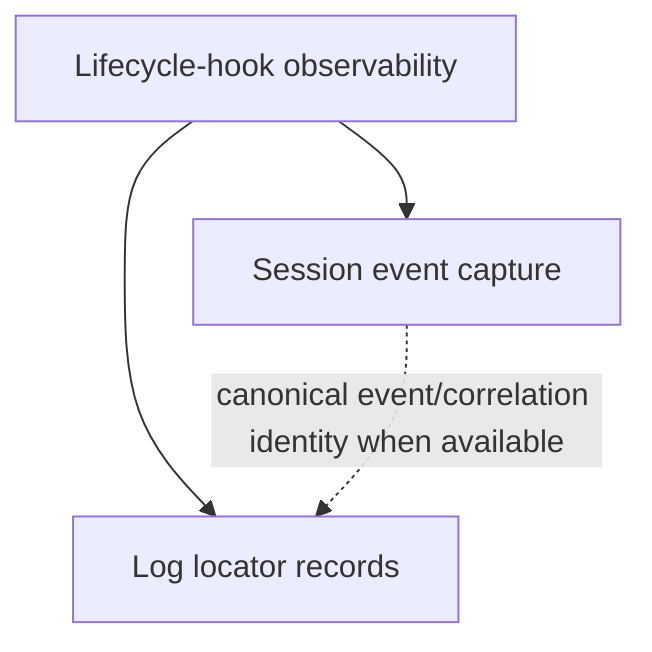

<!-- aligned-structure:v2 -->

# VS Code Copilot lifecycle-hook observability

## Motivation

Configured VS Code/Copilot lifecycle-hook executions need one observable, canonical Session API representation and metadata-only log artifact locators. The prior capture/sync and broad diagnostics slices do not define that per-invocation contract.

## Reading Order

1. This root for shared constraints and the component relationship.
2. [Session lifecycle-hook invocation events](../86e20b9e-7f6d-4a51-a51c-8dd0f2fe68cc/spec.toml) for canonical event semantics.
3. [Lifecycle-hook log locator records](../0f675354-6404-4eaf-ac7b-655a89cf9825/spec.toml) for metadata-only artifact behavior.
4. [VS Code Copilot capture-hook session sync](../09f96d83-4795-4f19-9259-64ad0d452387/spec.toml) and [runtime diagnostics](../aa769a27-2721-4b9d-880c-5c4e2f8136a7/spec.toml) as legacy context only.
5. [Canonical MCP-router call events](../../../../../../.workflow-tools/spec/specs/0c129254-0e31-4088-a61c-11f52d82a0e7/spec.toml) as a distinct event source, not a lifecycle-hook contract.

## Component Relationship Map

| Component | Owns | Depends on |
|---|---|---|
| `session-api` | One canonical tool-like event per configured lifecycle-hook invocation. | Session API canonical event/correlation model. |
| `log-api` | Metadata-only locator record, fetch, and list behavior. | Canonical event/correlation identity when available. |

## Shared Invariants

- One configured VS Code/Copilot lifecycle-hook execution is one invocation and produces exactly one canonical Session API event, including unsuccessful completion.
- Locator records may join to canonical event/correlation identity when available and remain valid when unavailable.
- Events and locator records never store raw log/artifact content.
- The scope does not change Cline, another hook system, unrelated MCP-call semantics, or the broad event schema.

## Dependent Expectation

Consumers can rely on a stable canonical invocation identity for joining configured VS Code/Copilot hook observations to locator metadata when known, while safely handling absent linkage and never receiving raw log content from either contract.

## Positions

- `not-implemented` — code_ref: [Session API owner](../../../../../session/crates/session-api/); this root requires canonical event behavior but does not claim implementation.
- `not-implemented` — code_ref: [session capture-hook entrypoint](../../../../../session/src/bin/session-capture-hook/main.rs); adapter mapping is required by the Session child.
- `not-implemented` — code_ref: [log-api owner](../../../../../log/crates/log-api/); locator behavior is required by the log child.

## Guards

- `val-hook-observability-integration` — required validation-spec guard for cross-component exactly-once capture, optional linkage, and content exclusion.

## Acceptance Criteria

| ID | Testable requirement | Required evidence |
|---|---|---|
| ROOT-1 | One configured-hook execution yields exactly one canonical Session API event and, when correlation exists, a locator can preserve that join. | Cross-component fixture guarded by `val-hook-observability-integration`. |
| ROOT-2 | A locator records, fetches, and lists when canonical event/correlation identity is absent. | Unlinked-locator fixture guarded by `val-hook-observability-integration`. |
| ROOT-3 | Serialized events and locator records contain no raw artifact content. | Negative persistence/response assertions guarded by `val-hook-observability-integration`. |

## Examples

A configured `PreToolUse` command exits nonzero. Session API records exactly one tool-like event with its identity, trigger, configured path, and outcome. log-api may retain a locator and correlation link, but never command output bytes.

## Evidence

Planned evidence only: `val-hook-observability-integration`; its test-api records are intentionally not created by this spec-only change. Child implementation owners: [W4 — Record configured Copilot lifecycle-hook invocations as canonical session events](../../../../../.workflow-tools/ticket/tickets/16ea5791-a3f1-4c3e-aa1f-eec6e3fd5c84/ticket.toml) owns the Session API child; [W5 — Store general-tool and Copilot hook log locator metadata](../../../../../.workflow-tools/ticket/tickets/141d7917-41e7-4745-985f-b300ce76d95d/ticket.toml) owns the log-api child. Related implementation/relocation work: [4d6d6301 shared agent hooks relocation](../../../../../../.workflow-tools/ticket/tickets/4d6d6301-0b2c-4da0-9c01-4c9f7d1a1002/ticket.toml).

## Scope

Included: VS Code/Copilot configured lifecycle hooks, canonical tool-like Session API events, and metadata-only locator record/fetch/list for general-tool and configured-hook artifacts.

Excluded: Cline; other hook systems; raw log-content persistence; unrelated MCP-call semantics; broad event-schema redesign; and implementation.